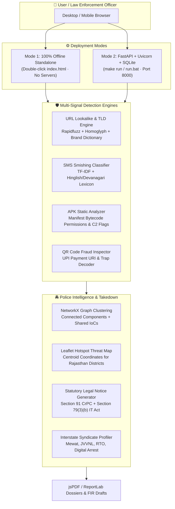
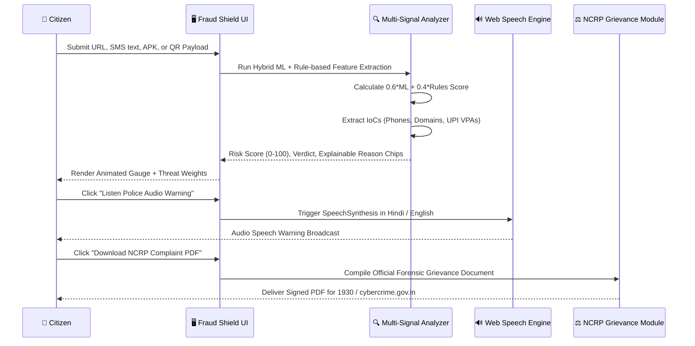
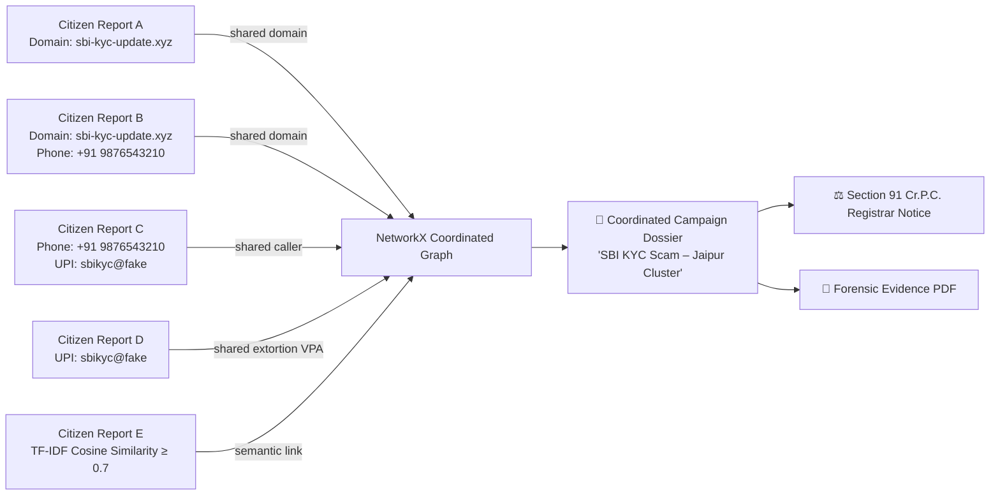

# Fraud Shield — Architecture Specification
### *Detect. Connect. Dismantle.*
**Rajasthan Police Hackathon 2026 · Problem Statement 01**  
**Team: Dholakpurwale · MIT Academy of Engineering**

---

## 1. Dual Execution Architecture

Fraud Shield features a robust dual execution model:
1. **Standalone Offline Client Engine (`index.html`):** Zero-dependency, pure client-side execution running directly via `file:///` in any modern browser. Features full client-side URL lookalike parsing, SMS social engineering detection, QR code UPI collect trap decoding, APK manifest static analysis, Canvas gauge and graph rendering, Web Speech API audio warnings, and jsPDF document generation.
2. **Full-Stack Microservice Engine (`/backend`):** High-throughput FastAPI service with SQLite database, scikit-learn machine learning classifiers, NetworkX graph connected components, and Server-Sent Events (SSE) live threat feed.

---

## 2. Citizen Checker Data Flow

---

## 3. NetworkX Coordinated Campaign Clustering

---

## 4. Multi-Signal Scoring Formulation

$$\text{Final Risk Score} = 0.6 \times (\text{ML Model Probability} \times 100) + 0.4 \times (\text{Rules Weight Hit})$$

### Risk Stratification:
- **0 – 39: Safe (Green)** &rarr; Standard domain/sender telemetry, verified SSL/TLS, no social engineering urgency keywords.
- **40 – 69: Suspicious (Orange)** &rarr; Unverified sender, generic shorteners, moderate brand resemblance, unencrypted HTTP.
- **70 – 100: High Risk (Red)** &rarr; Brand lookalike/typosquatting &ge; 65%, suspicious TLD (`.xyz`, `.top`, `.click`), social engineering keywords, dangerous APK permissions (`READ_SMS` + `SYSTEM_ALERT_WINDOW`), or deceptive UPI refund collect request.

---

## 5. Security & Safety Compliance

- **Zero Untrusted Execution:** APK files are subjected strictly to static manifest analysis. Binaries are never executed or emulated.
- **100% Offline Capability:** All ML weights, lookup tables, and threat signatures reside locally. No external paid APIs or telemetry keys are required.
- **Synthetic Data Governance:** All complaints, phone numbers, and names are synthetically generated for hackathon benchmarking. The `⚗️ Synthetic demo data` watermark is enforced across all dashboard views.
